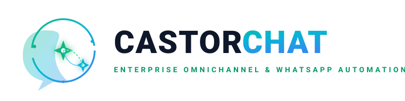

<p align="center">
  
</p>

<p align="center">
  <strong>Enterprise Omnichannel Customer Service &amp; WhatsApp Automation Desk</strong><br>
  <em>Institutional Multi-Channel Conversations, AI Agent Escalation, and Zero Per-Seat SaaS Taxes</em>
</p>

<p align="center">
  <a href="https://github.com/wtfear/CastorChat/actions/workflows/ci.yml"></a>
  
  
  
  
  
</p>

---

## 🌟 Executive Overview

**CastorChat** is an institutional-grade, self-hosted omnichannel engagement and customer communication desk built for enterprises, agencies, and high-velocity commerce operations. Named after **Castor**, the brightest alpha star in the Gemini constellation representing dual synchronous communication, CastorChat replaces exorbitant per-seat customer support platforms (Intercom, Zendesk, Freshdesk) with a completely self-hosted, sovereign conversation ecosystem.

With native first-class integrations for **Meta WhatsApp Cloud API**, website live chat, Instagram direct messages, Facebook Messenger, business email, Telegram, and SMS, CastorChat delivers unified customer interaction queues, AI-assisted canned responses, team routing, and real-time analytics under a 100% permissive open-source license.

---

## 🏛️ Agency & Enterprise Capabilities

### 1. 📱 Native WhatsApp Cloud API & Business Automation
- Direct connection to **Meta WhatsApp Cloud API** without third-party intermediary markups.
- Automated template message dispatching, interactive list pickers, and quick-reply buttons.
- Inbound media routing (audio voice notes, PDFs, images, delivery receipts).
- 24-hour customer care window management and CRM sync.

### 2. 💬 Next-Gen Live Website Widget
- Ultra-lightweight Vue 3 / Vite chat widget (<40KB embed) with zero impact on Core Web Vitals.
- Real-time presence indicators, typing status, file attachments, and emoji pickers.
- Automated lead capture forms, pre-chat qualification, and custom branding themes.

### 3. 📥 Unified Multi-Channel Inbox
- Single unified pane of glass consolidating WhatsApp, Instagram DMs, Facebook, Email (IMAP/SMTP), Twilio SMS, and Telegram.
- Multi-team department routing (Sales, Technical Support, VIP Escalations).
- Private internal agent notes, `@mention` team collaboration, and conversation auto-assignment.

### 4. 🤖 AI Copilot & Automation Workflows
- Macro playbooks, custom canned replies, and automated SLA breach notifications.
- Webhook triggers for real-time CRM updates (PolarisERP, AldebaranCRM, HubSpot).
- Native REST APIs for programmatic message injection, customer data enrichment, and bot handoffs.

### 5. 🔒 Enterprise Data Sovereignty
- 100% on-premise or private cloud deployment (Render, AWS, GCP, Azure, Bare-Metal Docker).
- Zero third-party telemetry, full GDPR, HIPAA, and SOC-2 data compliance readiness.
- No per-agent fees: scale from 5 to 5,000 operators with deterministic hosting costs.

---

## 🛠️ Technology Stack

| Layer | Technologies |
| :--- | :--- |
| **Backend Core** | Ruby on Rails 7.2+, Puma Application Server, Sidekiq Enterprise Queue |
| **Frontend UI** | Vue.js 3, Vite, Tailwind CSS, ProseMirror Rich Text Editor |
| **Data & Vectors** | PostgreSQL 16 (with `pgvector` indexing), Redis (ActionCable + Caching) |
| **Orchestration** | Docker, Docker Compose, Render Blueprint (`render.yaml`) |
| **Protocols** | ActionCable WebSockets, Webhooks, REST API, IMAP/SMTP |

---

## 🚀 Instant Deployment

### Local / Production Docker Compose

Ensure Docker and Docker Compose are installed:

```bash
git clone https://github.com/wtfear/CastorChat.git
cd CastorChat

# Launch complete stack (Postgres + Redis + Rails + Sidekiq)
docker compose up -d

# Initialize database schema & seed admin
docker compose exec rails bundle exec rails db:chatwoot_prepare
```

Access the desk at `http://localhost:3000` and configure your first inbox.

---

### Cloud 1-Click Deployment (Render)

Deploy production-grade CastorChat with high-availability PostgreSQL and Redis in one click using Render:

1. Fork or push this repository to GitHub.
2. In Render, select **Blueprints** -> **New Blueprint Instance**.
3. Select this repository; Render will automatically parse [`render.yaml`](./render.yaml) and provision:
   - `castor-chat-web` (Docker Web Service)
   - `castor-chat-sidekiq` (Background Queue Worker)
   - `castor-chat-db` (Managed PostgreSQL 16)
   - `castor-chat-redis` (Managed Redis Cache)

---

## 📂 Repository Structure

```
CastorChat/
├── app/                  # Rails MVC architecture (controllers, models, views, policies)
│   ├── javascript/       # Vue 3 / Vite frontend application & rich UI components
│   └── models/           # Conversation, Message, Inbox, and Account data models
├── config/               # Application configuration, routing, and environment settings
├── db/                   # Database migrations, pgvector schema, and seeds
├── docker/               # Production and development Dockerfiles and entrypoints
├── public/               # Public assets, icons, and CastorChat brand vectors
│   ├── brand-assets/     # CastorChat logo variations (light, dark, thumbnail)
│   └── castor-logo.svg   # Primary Gemini twin star brand emblem
├── docker-compose.yml    # Root 1-click production container orchestration
├── render.yaml           # Turnkey Render Infrastructure-as-Code specification
└── README.md             # Institutional documentation
```

---

## 📜 Licensing

CastorChat Community is open-source software licensed under the permissive **[MIT License](LICENSE)**.

---

<p align="center">
  Built with pride by the <strong>WTFear</strong> Open-Source Enterprise Initiative.
</p>
